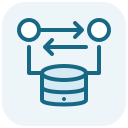

<p></p>

# IDBShift

Test whether your IndexedDB data still makes sense after an application upgrade, rollback, and second upgrade.

IDBShift runs your old and new storage code in real Chromium documents, preserves the database between stages, and checks the data contract you declare. It produces a text summary, JSON diagnostics, and an HTML report that opens offline.

[](https://github.com/0then0/idbshift/actions/workflows/ci.yml)
[](https://github.com/0then0/idbshift/releases/latest)
[](LICENSE)
[](CHANGELOG.md)
[](docs/verification.md)

## Why test rollback?

Suppose A stores `{ id, name }`. B adds a calculated `normalizedName`, an index, and a migration that fills the new field. A → B succeeds.

Now roll the application back. A replaces an existing record and adds another without `normalizedName`. When B returns, the database version is already current, so the migration does not run again. Both records can exist while the new index returns neither of them.

The included Dexie example adapts the application compatibility risk described in [Dexie #2097](https://github.com/dexie/Dexie.js/issues/2097), using the pinned Dexie 4.4.7 baseline. It does not reproduce the author's complete production environment or establish an IndexedDB defect.

## Get started

Requirements: Node **24.22.1 LTS**, npm **11.19.1**, and Playwright's Chromium. IDBShift currently runs from a source checkout; it is not published to npm.

```sh
git clone https://github.com/0then0/idbshift.git
cd idbshift
npm ci
npx playwright install chromium
npm run experiment
```

On Linux, use `npx playwright install --with-deps chromium` to install browser prerequisites.

Open **`reports/report.html`** in your browser. You can inspect the timeline, expand expected/actual values, and download the JSON without starting a web server. `report.json` and `report.txt` are also saved in the same directory.

The default experiment exits **1** because it includes an actual contract violation. The acceptance suite checks that this counterexample is detected:

- **Dexie upgrade:** A → B passes.
- **Dexie rollback:** A → B → A-write → B violates the original data contract.
- **Dexie repair control:** the rollback history passes with an explicit B policy that repairs the derived field when opening.
- **Native IndexedDB ledger:** A → B preserves signed entries and their balance.
- **Native rollback refusal:** A → B → A-refusal → B accepts a declared `VersionError` policy, without allowing rollback writes.

[Browse the example histories](examples/histories.ts) or inspect the [recorded results](docs/verification.md).

## Write a history

Start with the small runnable ledger scenario:

```sh
cp examples/minimal.ts examples/my-history.ts
npm run experiment -- --scenario examples/my-history.ts --out reports/my-history
```

Each scenario module exports a `histories` array. Versions point to browser entrypoints; stages declare operations and independent checks:

```ts
import type { History } from 'idbshift';

export const histories: History[] = [
  {
    id: 'ledger-upgrade',
    databaseName: 'disposable-ledger',
    versions: {
      A: { appVersion: 'ledger-A', entrypoint: '/examples/native/A.ts' },
      B: { appVersion: 'ledger-B', entrypoint: '/examples/native/B.ts' },
    },
    deadlineMs: 10_000,
    stages: [
      {
        id: 'prepare-A',
        version: 'A',
        operations: [{ name: 'deposit', input: { id: 1, cents: 1200 } }],
        checks: [
          {
            name: 'The deposit is readable',
            run: async ({ query }) => ({
              expected: [{ id: 1, cents: 1200 }],
              actual: await query('entries'),
            }),
          },
        ],
      },
      {
        id: 'open-B',
        version: 'B',
        checks: [
          {
            name: 'The balance is preserved',
            run: async ({ query }) => ({ expected: 1200, actual: await query('balance') }),
          },
        ],
      },
    ],
  },
];
```

To test rollback, append an A stage with real writes and another B stage with checks. Seed only in the preparation stage. The runner neither reseeds nor imports a database snapshot between stages.

Every history owns a fresh, non-persistent browser context. Its stages keep the same origin, port, and database name, but execute in separate documents. The previous document is closed before the next one opens.

## Connect your storage code

Create an entrypoint for each version that default-exports `defineAdapter(...)`. Map its operations and read-only queries to your application's storage API:

```ts
import { defineAdapter } from 'idbshift/browser';
import { openStorage } from './my-app/storage-a.js';

export default defineAdapter({
  appVersion: 'A',
  async open({ databaseName }) {
    const storage = await openStorage(databaseName);
    return {
      database: storage.nativeDatabase, // The actual IDBDatabase connection.
      close: () => storage.close(),
      operations: { save: (input) => storage.save(input) },
      queries: { summary: () => storage.readSummary() },
    };
  },
});
```

The [Dexie adapter](examples/dexie/storage.ts) and [native IndexedDB adapter](examples/native/storage.ts) are complete implementations. For Dexie, expose `db.backendDB()` as the native connection.

Queries must not repair, seed, or migrate data. Put any reconciliation policy explicitly in the executed application version's `open` or write path. The included repair control checks exact normalized values and index keys; it is one application policy, not a general migration fix.

Vite serves these local entrypoints and their imports. IDBShift does not automatically adapt arbitrary websites or production bundles. The `idbshift` imports above resolve to this checkout's public exports. See the [adapter contract](docs/adapter-contract.md) for deadlines, cancellation, refusal policies, and supported diagnostic values.

## Read the result

- **`passed`**: every executed stage completed its declared checks. PASS applies only to that history and those assertions.
- **`contract-violation`**: expected and actual data differed. Later stages can still add evidence; the first violation remains recorded.
- **`open-refused`**: the application declined the database unexpectedly, or native IndexedDB raised `VersionError`.
- **`expected-refusal`**: the declared refusal policy matched. This is not proof that both versions can write safely.
- **`blocked`**: cancellation or a stage deadline prevented completion. This does not establish data loss.
- **`error`**: adapter, assertion code, configuration, shutdown, or infrastructure failed.

Stages skipped after an operational failure are marked `not-run`. Reports show operations, application and native database versions, durations, selected expected/actual values, and failure reasons. Diagnostic values are captured when each check completes.

Exit codes are **0** for passed histories or accepted refusal policies, **1** for an unsuccessful history, **2** for CLI setup/export errors, and **130** for cancellation. See the [report format](docs/report-format.md) for the JSON contract and verdict precedence.

## Use Playwright Test

```ts
import { test, expect } from 'idbshift/playwright';
import { histories } from './my-history.js';

test('storage compatibility', async ({ idbshift }) => {
  const history = histories[0];
  if (!history) throw new Error('Missing history');
  const report = await idbshift(history);
  expect(report.verdict).toBe('passed');
});
```

The fixture manages the local host and contexts, adds named Playwright steps, and attaches all three reports. It returns the verdict so your test can assert a passing history, an expected violation, or a refusal policy. Set the outer test timeout above the sum of stage deadlines and shutdown allowances.

## How it fits

A migration runner applies schema changes. IDBShift tests old and new application operations around them. An IndexedDB viewer inspects current state. IDBShift records the history that led to a discrepancy. A regular Playwright test can implement the same experiment; this project supplies the lifecycle contract, identity guards, first-failure handling, and portable reports.

## Scope

v0.1 runs sequential, single-database histories in Chromium. See [testing and compatibility](docs/verification.md) for verified environments and CI targets.

There is no web application for editing or launching scenarios. The user interface is the generated offline report. Service workers, Cache Storage, OPFS, SQLite WASM, cloud sync, CRDT, crash/power-loss testing, quota/eviction, concurrent tabs, browser extensions, and automatic migration repair are outside the current scope. There is no hosted service or telemetry.

Run trusted adapters with disposable data. Reports contain selected diagnostics, not a database dump. `--trace` explicitly enables separate Playwright traces, which may contain sensitive browser details and must be reviewed before sharing. A trace supplements assertions; it does not prove semantic correctness. Read the [security policy](SECURITY.md) before sharing artifacts.

## Development

```sh
npm run check
```

See [CONTRIBUTING.md](CONTRIBUTING.md) for the verification workflow and [dependency policy](docs/dependency-policy.md) before changing pins. IDBShift is licensed under [Apache-2.0](LICENSE); dependencies retain their [own licenses](THIRD_PARTY_NOTICES.md).
